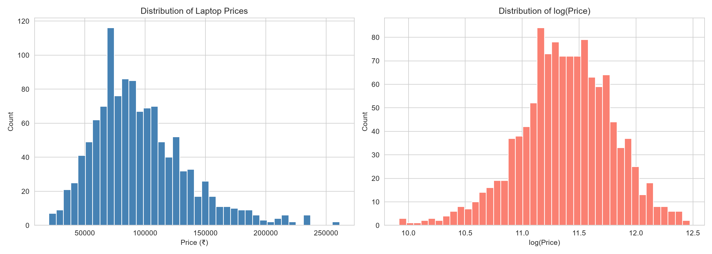
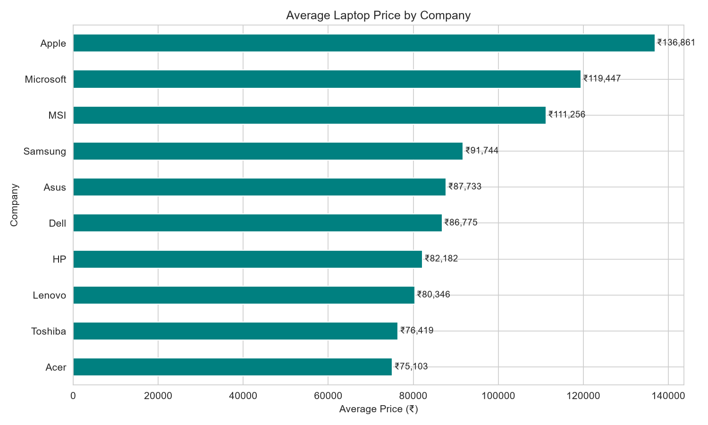
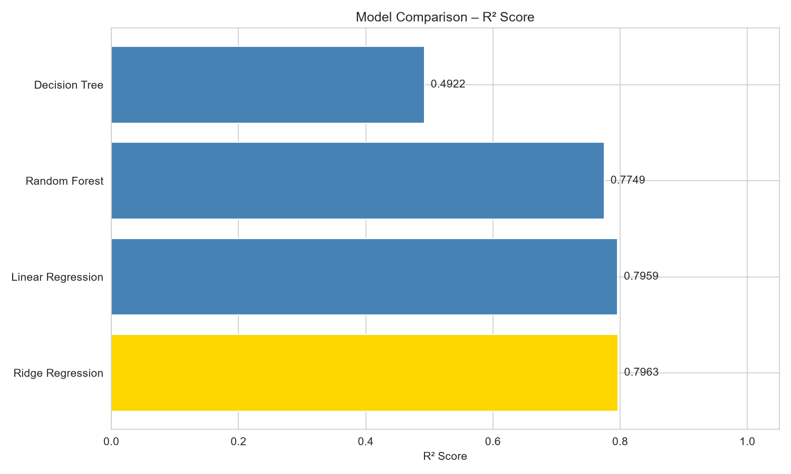

# 🔮 Laptop Price Prediction Using Machine Learning

A complete **Regression-based Machine Learning project** that predicts the price of a laptop based on its specifications. The project includes a full ML pipeline (from data preprocessing to model evaluation) and a **Streamlit web application** for interactive predictions.

---

## 📋 Problem Statement

Laptops come in a wide variety of configurations and price ranges. Predicting a fair market price from specifications helps both buyers and sellers make informed decisions.

This system uses Machine Learning to predict the **price of a laptop (in ₹ INR)** based on features such as:
- Company / Brand
- Laptop Type (Notebook, Gaming, Ultrabook, etc.)
- RAM, Storage (HDD / SSD)
- Processor (CPU brand)
- GPU (Graphics card brand)
- Screen Size, Resolution & Display features
- Operating System
- Weight

---

## 📊 Dataset Description

| Property | Details |
|----------|---------|
| **Source** | Synthetically generated with realistic correlations |
| **Rows** | ~1,200 laptop records |
| **Target Variable** | `Price` (in Indian Rupees ₹) |
| **Features** | Company, TypeName, Inches, ScreenResolution, Cpu, Ram, Memory, Gpu, OpSys, Weight |

### Engineered Features
During preprocessing, the following features are extracted:
- **Ram** (int) – extracted from `"8GB"` → `8`
- **Weight** (float) – extracted from `"2.1kg"` → `2.1`
- **Touchscreen** (0/1) – from ScreenResolution
- **IPS** (0/1) – from ScreenResolution
- **PPI** (float) – Pixels Per Inch, calculated from resolution & screen size
- **Cpu_brand** (category) – Intel Core i3/i5/i7, AMD Processor, Other
- **HDD** (int GB) – from Memory column
- **SSD** (int GB) – from Memory column
- **Gpu_brand** (category) – Intel, Nvidia, AMD
- **OpSys** (category) – Windows, Mac, Linux/Other

---

## 🛠️ Technologies Used

| Technology | Purpose |
|-----------|---------|
| **Python 3.8+** | Programming language |
| **Pandas** | Data manipulation |
| **NumPy** | Numerical computation |
| **Matplotlib & Seaborn** | Data visualization |
| **Scikit-learn** | ML models, Pipeline, preprocessing |
| **Streamlit** | Interactive web application |
| **Joblib** | Model serialization |

---

## 🤖 Machine Learning Models

The following regression models are trained and compared:

| # | Model | Description |
|---|-------|-------------|
| 1 | **Linear Regression** | Baseline linear model |
| 2 | **Ridge Regression** | L2-regularized linear model |
| 3 | **Decision Tree Regressor** | Non-linear tree-based model |
| 4 | **Random Forest Regressor** | Ensemble of decision trees (usually best) |

The **best model is automatically selected** based on R² Score and further improved via **RandomizedSearchCV hyperparameter tuning** and **5-fold cross-validation**.

---

## 📏 Evaluation Metrics

| Metric | Description |
|--------|-------------|
| **R² Score** | Proportion of variance explained (closer to 1 is better) |
| **MAE** | Mean Absolute Error |
| **MSE** | Mean Squared Error |
| **RMSE** | Root Mean Squared Error |

---

## 📁 Project Structure

```
Laptop_Price_Prediction/
│
├── data/
│   ├── laptop_data.csv          # Dataset (generated)
│   └── generate_data.py         # Script to generate dataset
│
├── notebooks/
│   └── laptop_price_prediction.py   # Full ML pipeline (Parts 1-12)
│
├── models/
│   ├── laptop_price_model.pkl   # Trained model pipeline
│   └── metadata.pkl             # Feature metadata for the app
│
├── plots/                       # EDA & model visualizations
│   ├── 01_price_distribution.png
│   ├── 02_avg_price_by_company.png
│   ├── 03_ram_vs_price.png
│   ├── 04_cpu_vs_price.png
│   ├── 05_correlation_heatmap.png
│   ├── 06_type_vs_price.png
│   ├── 07_actual_vs_predicted.png
│   ├── 08_feature_importance.png
│   └── 09_model_comparison.png
│
├── app.py                       # Streamlit web application
├── requirements.txt             # Python dependencies
└── README.md                    # This file
```

---

## 🚀 How to Run the Project

### Prerequisites
- Python 3.8 or higher
- pip (Python package manager)

### Step 1: Clone / Download the Project
```bash
cd Laptop_Price_Prediction
```

### Step 2: Install Dependencies
```bash
pip install -r requirements.txt
```

### Step 3: Generate the Dataset
```bash
python data/generate_data.py
```
This creates `data/laptop_data.csv` with ~1,200 laptop records.

### Step 4: Train the Model
```bash
python notebooks/laptop_price_prediction.py
```
This will:
- Load and preprocess the data
- Perform EDA and save plots to `plots/`
- Train and evaluate multiple models
- Tune the best model with hyperparameter search
- Save the final model to `models/`

### Step 5: Run the Web Application
```bash
streamlit run app.py
```
Open the URL shown in the terminal (usually `http://localhost:8501`).

---

## 🖼️ Screenshots

> *Add screenshots of the Streamlit app and EDA plots here.*

| Screenshot | Description |
|-----------|-------------|
|  | Distribution of laptop prices |
|  | Average price by company |
|  | R² Score comparison across models |

---

## 🔮 Future Improvements

- [ ] Use a real-world dataset (e.g., from Kaggle or Flipkart scraping)
- [ ] Add more models (XGBoost, Gradient Boosting, SVR)
- [ ] Deploy the app to Streamlit Cloud / Heroku / AWS
- [ ] Add price range prediction (confidence intervals)
- [ ] Add a "Compare Laptops" feature in the web app
- [ ] Include laptop brand logos and images
- [ ] Add a recommendation system based on budget
- [ ] Implement SHAP values for model explainability

---

## 📝 License

This project is for educational purposes. Feel free to use, modify, and distribute.

---

## 🙏 Acknowledgements

- Scikit-learn documentation
- Streamlit documentation
- Laptop pricing domain knowledge

---

<p align="center">
  Built with ❤️ using Python, Scikit-learn & Streamlit
</p>
